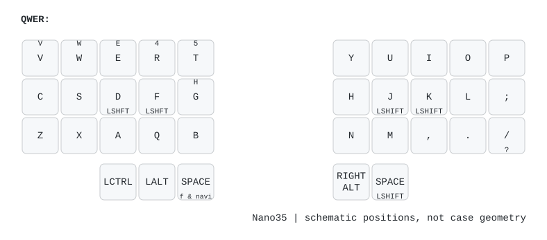

# Charybdis Nano 35 + USB Dongle

Charybdis Nano 35키를 기존 nRF52840 USB 동글에 연결하는 독립 ZMK 구성입니다.
왼손 18키·오른손 17키/PMW3610은 BLE peripheral, 동글은 BLE central 및 USB keyboard/mouse입니다.
판매자 펌웨어를 분석한 실제 4×5 배선을 사용합니다.

## 키맵



TOTEM 키맵에서 양쪽 바깥 Shift와 오른쪽 세 번째 엄지를 제외했습니다.
QWERTY/NAV/NUM/OSL 뒤에 Keyball39의 MOUSE/SCROLL/SNIPE와 FASTER를 추가했습니다.
MOUSE에서 위치 3을 누르는 동안 FASTER, 위치 2+3을 함께 누르는 동안 SNIPE가 켜집니다.
FASTER의 1/21번은 일반 속도를 바꾸지 않는 전용 ±10%p 조절입니다.

- [8개 레이어 전체 그림](keymap-drawer/nano35.svg)
- [콤보 그림](keymap-drawer/nano35-combos.svg)
- [35키 위치와 토템 매핑](docs/totem35-keymap.md)
- [트랙볼 조작과 감도](docs/trackball-modes.md)

키의 위 표시는 mod-morph의 대체 입력 또는 2x(더블탭), 아래 표시는 홀드 동작입니다.
콤보 위의 L0–L7는 적용 레이어 번호(QWERTY/NAV/NUM/OSL/MOUSE/SCROLL/SNIPE/FASTER 순)입니다.
투명 키(▽)는 아래 활성 레이어를 따릅니다. 그림은 키 순서를 나타내는 평면 도식이며 케이스 형상은 아닙니다.
원본은 `config/nano35.keymap`, 위치는 실제 펌웨어의 `nano35.dtsi`에서 읽습니다.
키맵을 수정해 push하면 **Draw ZMK keymap** Actions가 그림을 생성하고 기본 브랜치에 갱신합니다.
로컬 생성: `python -m pip install -r requirements-draw.txt` 후 `python scripts/draw-keymap.py`.

## Keymap Editor로 편집

[Keymap Editor](https://nickcoutsos.github.io/keymap-editor/)에서 이 저장소의 `main` 브랜치와
`config/nano35.keymap`을 선택합니다. 같은 폴더의 `config/info.json`이 35키 레이아웃을 제공합니다.
왼손 3개·오른손 2개 엄지와 키 순서는 펌웨어의 `nano35.dtsi`에 맞췄습니다.
케이스 곡면 형상을 생략한 평면 도식입니다.

이미 열려 있으면 새로고침 후 저장소/브랜치를 다시 선택해 최신 파일을 불러옵니다.
수정 내용을 저장하면 GitHub가 OLED UF2와 키맵 그림을 다시 생성합니다.
Studio 펌웨어는 필요하지 않습니다. 편집기의 `row`/`col`은 화면상의 위치이며 실제 GPIO 매트릭스 번호가 아닙니다.
레이아웃 형식은 [공식 문서](https://github.com/nickcoutsos/keymap-editor/wiki/Defining-keyboard-layouts)를 따릅니다.

## 트랙볼 빠른 조작

기본 레이어에서 공을 움직이면 Mouse가 자동 진입합니다. V+P로 수동 진입할 수도 있습니다.
Mouse에서 2(E) 홀드는 Scroll, 3(R) 홀드는 FASTER, 2+3은 SNIPE입니다. D/F 또는 K/L은 좌/우 클릭,
K+L은 가운데 클릭입니다. 오른손 엄지로 기본 레이어에 복귀합니다.
Snipe의 T 위치는 부트로더 진입입니다. 자세한 타이머·감도 동작은 위 모드 안내를 참고하세요.

일반 포인터에는 느린 움직임 1배·빠른 움직임 최대 1.75배 가속을 적용합니다.
센서는 400 CPI를 유지하고 Scroll/Snipe에는 가속을 적용하지 않습니다.
OLED는 5분 무입력 후 꺼지며 밝기 설정은 그대로입니다.
[OLED 프리셋 타이머](docs/pomodoro.md)는 기존 표시를 유지하는 배치입니다.
OSL에서 **J=5분 / K=10분 / L=25분 / ;=종료**입니다. 진행 중 다시 누르면 새로 시작합니다.
완료 시 DONE과 축하 그림, 전체 화면 10초 점멸 후 1분 추가 표시(총70초)를 제공합니다.

## 펌웨어

GitHub의 **Actions → Build Nano35 firmware → 성공한 실행 → Artifacts**에서 받습니다.

현재 자동 빌드는 **`nano35-dongle-oled.uf2` 하나만** 생성합니다.
이미 연결된 좌우 반쪽은 그대로 사용하고 동글만 업데이트합니다.

기본 동글·왼손·오른손·초기화·Studio의 소스와 전체 빌드 목록은
`build-all.yaml`에 보존합니다. 나중에 모두 다시 만들려면 다음과 같이 목록을 복원하고 push합니다.

```powershell
Copy-Item -LiteralPath .\build-all.yaml -Destination .\build.yaml
git add build.yaml
git commit -m "Restore all firmware build targets"
git push
```

전체 목록의 OLED와 Studio는 각각 별도 선택 동글 빌드입니다.
[설치·복구](docs/flashing.md), [OLED 수정 기록](docs/oled-repair.md),
[호환성](docs/compatibility.md), [검증 상태](docs/validation.md)를 먼저 확인하세요.
기본 동글 USB 및 OLED 복구는 사용자 실기기 확인을 받았습니다.
기존 구성은 6개 로컬 빌드를 통과했습니다. 후속 가속은 ARM 회귀 검사를 통과했으며 실기기 검증은 대기 중입니다.

OLED는 배터리 출처를 L/R로 표시하고 활성 잠금 상태만 N/C/S로 표시합니다.
CPM 표시는 제거했습니다. [속도 버튼·OLED 안내](docs/mouse-speed-oled.md).

## 개발과 저장소 관리

- `config/`: 키맵·잠긴 west 의존성
- `boards/`, `snippets/`: 배선·동글·OLED 설정
- `src/`, `dts/`, `zephyr/`: 동글 트랙볼 모듈
- `scripts/`, `tests/`: 빌드·검사·그림 생성
- `keymap-drawer/`: 생성된 YAML/SVG (직접 수정하지 않음)
- `docs/`: 사용·개발 문서

[GitHub 업로드와 자동화](docs/github.md), [로컬 빌드](docs/development.md)를 참고하세요.
UF2, 설치 보관본, 과거 로그는 Git에서 제외하고 로컬에 보존합니다.
봉고캣/OLED 코드의 원본·수정 내역과 MIT 라이선스는
`boards/shields/nano35_status/UPSTREAM.md`, `LICENSE`에 보존되어 있습니다.

OLED의 예전 CPM 자리에는 현재 eCPI 또는 스크롤 배율을 표시합니다.
배터리는 L/R 접두가 잘리지 않도록 고정 폭을 사용합니다. [현재 속도·배터리 표시](docs/oled-speed-status.md).
